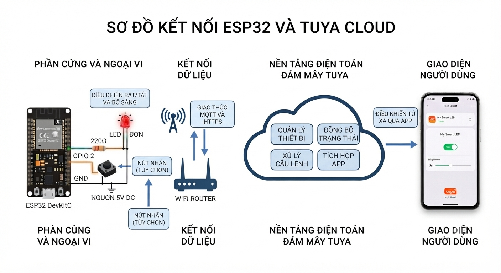
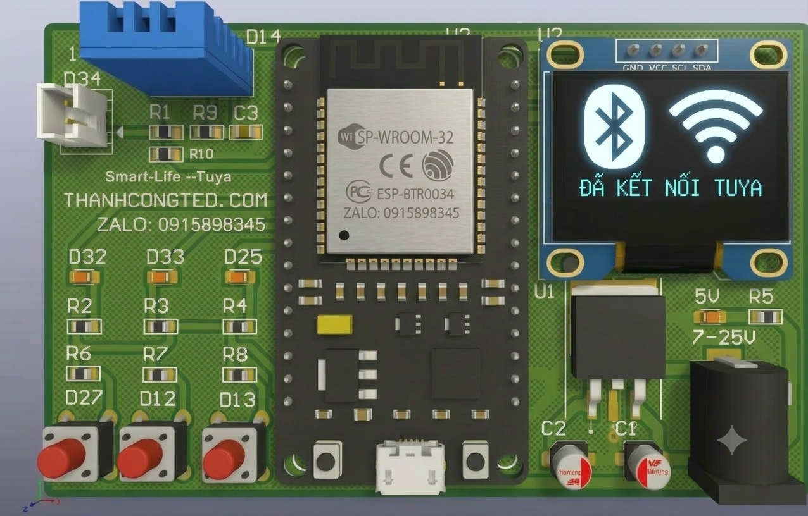
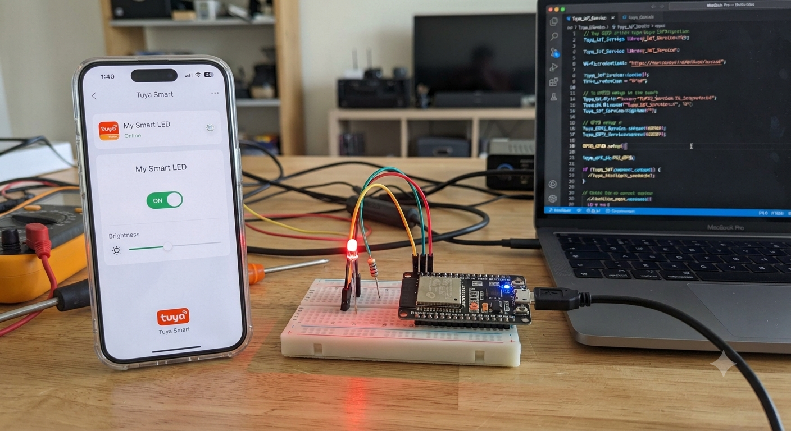

# Home

[Việt Nam](README.md) | [English](README_eng.md)

# Giới thiệu

Ted Tuya ESP32 là một framework phát triển IoT mã nguồn mở do ThanhCongTED phát trển cho nền tảng Arduino, cho phép nhiều lập trình viên Arduino nhanh chóng phát triển các thiết bị IoT dựa trên nền tảng đám mây Tuya và hiện thực hóa việc điều khiển thông minh từ xa đối với thiết bị.

Các sản phẩm IoT được phát triển dựa trên TED_TUYA_ESP32 có thể sử dụng các chức năng của component tuya_cloud_service để tận dụng hệ sinh thái mạnh mẽ do TuyaAPP hoặc SmartLife, các dịch vụ đám mây cung cấp, và có thể liên kết với các thiết bị của Tuya.

Đồng thời, TED_Tuya_ESP32 sẽ tiếp tục mở rộng, cung cấp thêm các chức năng truy cập nền tảng đám mây, cũng như các chức năng về giọng nói, video và nhận diện khuôn mặt, và TED_Tuya_ESP32 cũng sẽ được cập nhật để hỗ trợ nhiều chức năng hơn.

# Các chip được hỗ trợ 

Hiện tại, dự án hỗ trợ các chip ESP32.

| Chip |                          Datasheet                           |
| :--: | :----------------------------------------------------------: |
|  ESP32  | [ESP32](https://www.espressif.com/en/products/socs/esp32/resources) |

# Các hệ điều hành được hỗ trợ Arduino IDE

| Chip | Windows  | Linux |  macOS   |

|  ESP32  |   Hỗ trợ   | Hỗ trợ  | Hỗ trợ |

> Lưu ý: Một số chip chưa được hỗ trợ trên một số hệ điều hành nhất định, chúng tôi đang nỗ lực để hỗ trợ chúng, hãy chờ đón nhé!
# Các dùng thư viện TED_TUYA_ESP32
Bạn nên cài đặt và sử dụng phiên bản mới nhất của Arduino IDE 2, có thể tải xuống từ trang chủ chính 
thức của Arduino arduino.cc. Tất cả các công việc biên dịch, nạp và kiểm thử của dự án này đều được 
thực hiện trên Arduino IDE 2. 

install [TED_TUYA_ESP32](https://thanhcongted.com/webinstaller/esp_tuya_pay.html) 

## Giới thiệu phần cứng cho Bo mạch phát triển

+ [Bo mạch phát triển TED-ESP32](https://thanhcongted.com/)

## 📞 Hỗ trợ kỹ thuật
Mọi thắc mắc về firmware, vui lòng liên hệ:

📞 Điện thoại/Zalo: +84-915-898-345

✉️ Email: thanhcongted.info@gmail.com

🌐 Website: https://thanhcongted.com

## © Bản quyền
Phát triển bởi đội ngũ kỹ sư Việt Nam
Sản phẩm được thiết kế phù hợp với nhu cầu và thói quen sử dụng tại thị trường nội địa.
